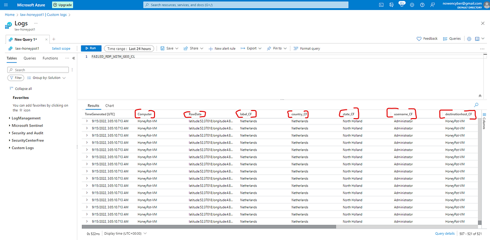
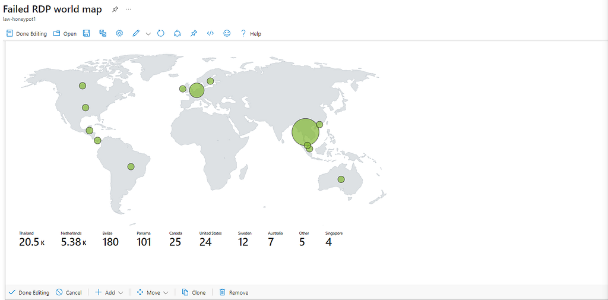

# Microsoft Sentinel Honeypot Lab

An Azure learning lab collecting failed Windows RDP sign-ins, enriching source IPs with geolocation data, and visualizing the results in Microsoft Sentinel.

**By Noah Owen · Lab completed: September 15, 2022**

[Lab walkthrough](docs/lab-walkthrough.md) · [Screenshots](#screenshots) · [Attribution](#attribution)

## Project status

This repository documents a completed learning lab from 2022. The walkthrough and screenshots describe the environment at that time. It has not been rebuilt or retested since; the screenshots do not establish that it is currently deployed.

## Technologies

Microsoft Azure · Microsoft Sentinel (formerly Azure Sentinel) · Windows 10 VM · Log Analytics · PowerShell · Windows Event Viewer · IP geolocation · Sentinel workbooks

## Lab workflow

1. Create an Azure Windows VM and a Log Analytics workspace.
2. Connect Microsoft Sentinel to the workspace.
3. Observe failed RDP sign-ins in Windows Event Viewer.
4. Use a PowerShell script and an IP geolocation API to enrich events.
5. Ingest the custom logs and extract geographic fields.
6. Create a workbook map showing the locations associated with the source IP addresses.

## Documented results

- Failed sign-in events collected from the Windows VM.
- Custom log fields extracted for mapping.
- A Sentinel workbook map visualizing source-IP geolocation.

**Historical lab boundary:** The original experiment deliberately allowed broad inbound access and disabled the VM firewall to attract traffic. This is documented historical behavior, not a recommended configuration for a support or production environment. Geographic points represent IP geolocation estimates, not verified attacker identities.

## Screenshots

### Parsed failed sign-in logs

Extracted geographic fields in Log Analytics.

### Sentinel failed RDP sign-in map

The workbook map showing the geographic distribution of source IP addresses.

[See the full walkthrough and screenshot sequence →](docs/lab-walkthrough.md)

## Repository contents

| Path | Contents |
| --- | --- |
| [docs/lab-walkthrough.md](docs/lab-walkthrough.md) | Lab walkthrough, available figures, and captions |
| [images/](images/) | 19 lab figures; one credential-bearing screenshot omitted |
| [docs/image-index.json](docs/image-index.json) | Local figure filenames and captions |

This repository does not include VM images, executable scripts, exported queries, deployment templates, or live credentials. Screenshots of code are historical evidence, not executable source files.

## Attribution

This lab follows [Josh Madakor’s SIEM Tutorial for Beginners](https://www.youtube.com/watch?v=H8W9oMNSuwo&list=PLxbwE86jKRgMpuZuLBivzlM8s2Dk5lXBQ). The original PowerShell script was downloaded for the exercise; its source is not included here and is not claimed as original work. The lab also uses [ipgeolocation.io](https://ipgeolocation.io/).

This lab is documented by [Noah Owen](https://github.com/Nowen99). Referenced third-party material retains its original ownership; this repository does not claim authorship of those resources or grant a new license for them.
