> By Noah Owen · Lab completed: September 15, 2022
> Screenshots and steps document the 2022 lab environment.

# In This Lab, I Setup Azure Sentinel (SIEM) and Connected it to a Live Virtual Machine Acting as a Honey Pot

In the lab, I observed live RDP Brute Force attacks from various locations worldwide. I then utilized a PowerShell script to find the attacker’s geolocation information and plot it on the Azure Sentinel Map.

To start, I established my Azure account and created a Windows 10 VM within Azure. I also created a network security group to act as a firewall and deleted the default inbound rules, creating my own that would allow any inbound traffic on any port, making the network extremely vulnerable. While the VM was deploying, I set up a log analytic workspace to collect logs from the VM and generate a custom log containing geographical information to track the attacker’s locations. I also added Microsoft Sentinel as the SIEM to visualize and map the attack data.

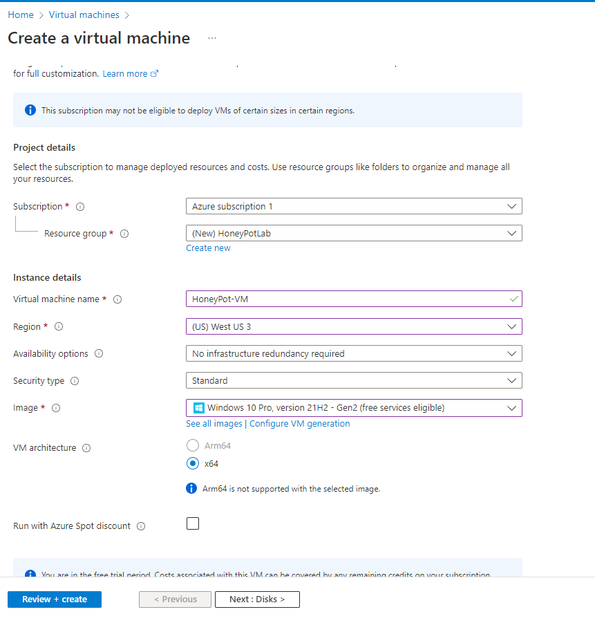

*Creating a VM Running Windows 10*

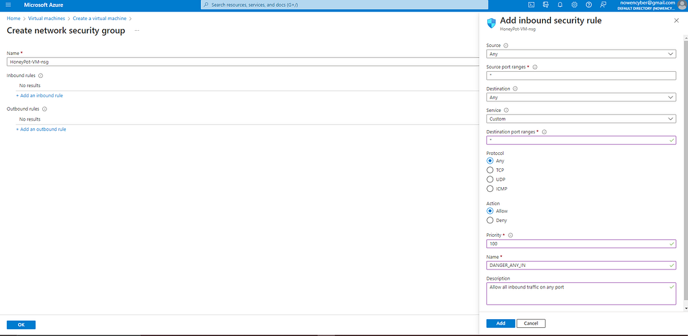

*Creating the Network Security Group and Inbound Security Rule*

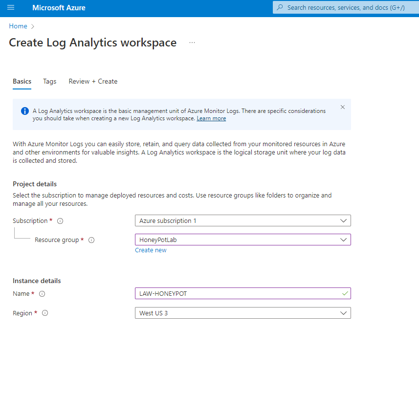

*Creating the Log Analytic Workspace*

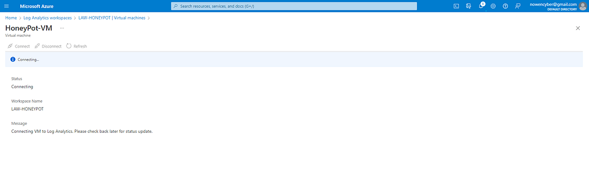

*Connecting the VM and the LAW*

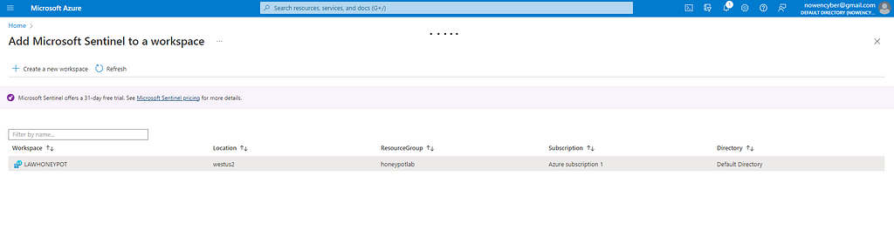

*Adding Microsoft Sentinel to the LAW*

Next, I logged into the VM using RDP and the public IP address. I then opened Event Viewer and attempted to log in with an incorrect password to see the details in Event Viewer. These failed login attempts would provide the data for the map.

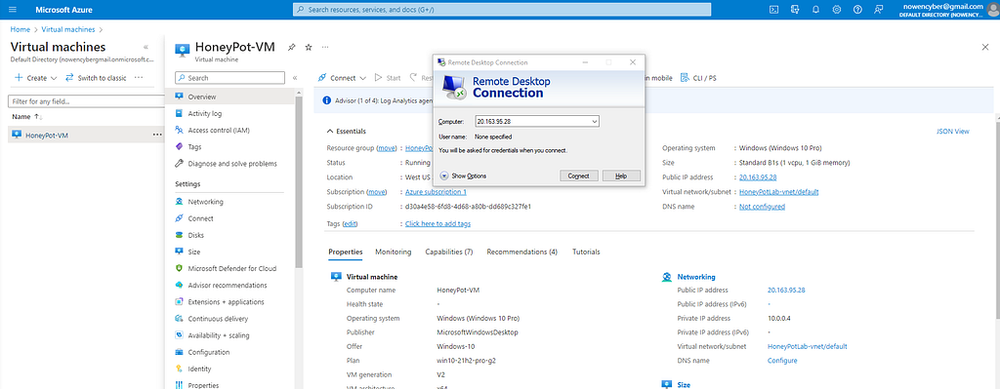

*Using RDP to Connect to the VM*

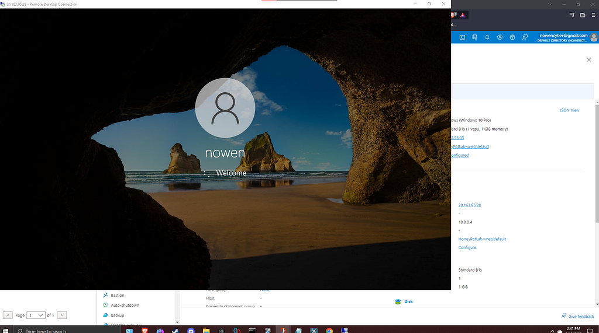

*Signing Into the VM*

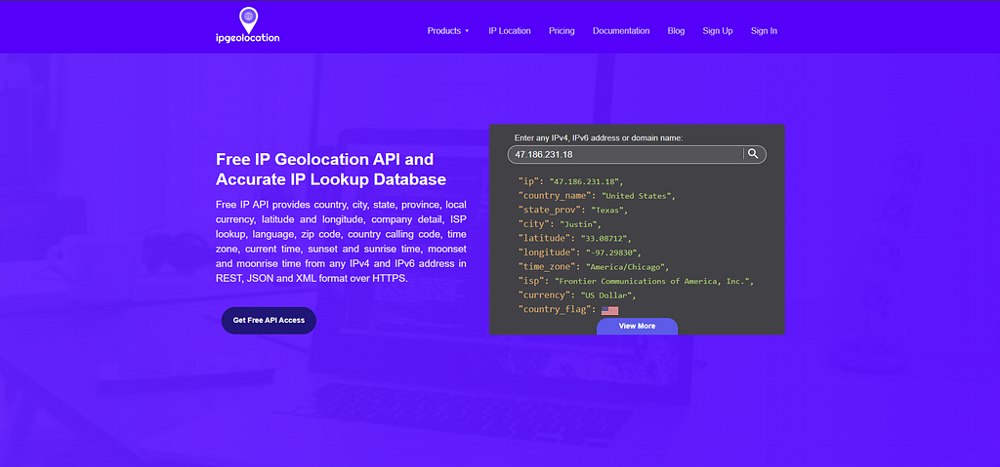

*Ipgeolocation.io*

Using PowerShell, I extracted the source IP addresses from the events in Event Viewer and inputted them into an IP geolocation API (ipgeolocation.io) to obtain extensive location information on the attackers. I then sent the log to the log analytic workspace in Azure and used Sentinel to read the latitude and longitude to plot the attacker’s locations on the map.

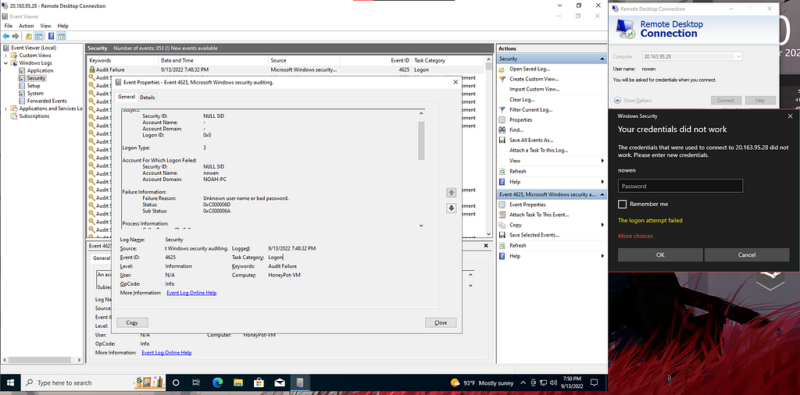

*Failed Attempt to Login Shown in Event Viewer*

To proceed, I disabled the Windows firewall to permit anyone to attack the machine. I also downloaded a PowerShell script to automatically export logs, checking Event Viewer’s security logs for failed login attempts and obtaining the attacker’s IP address to create a new log file.

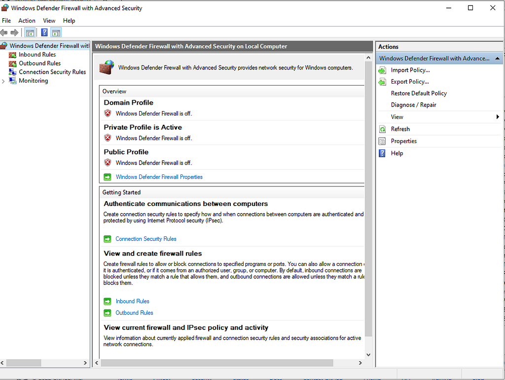

*Disabling Windows Firewall*

> Screenshot omitted because it contains an exposed API credential. The caption is retained below.

*Running the PowerShell Script*

As you can see event viewer was checked and a new log file was created with the location data of the failed logins. When it's time to map this data, we exclude the samples above my two failed logins.

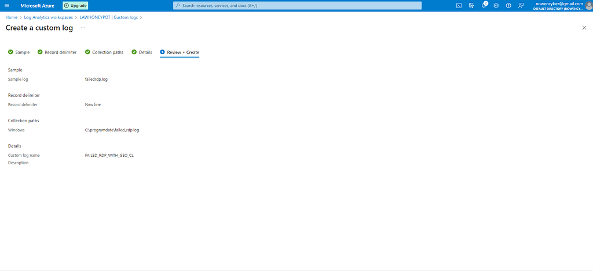

*Creating the Custom Log*

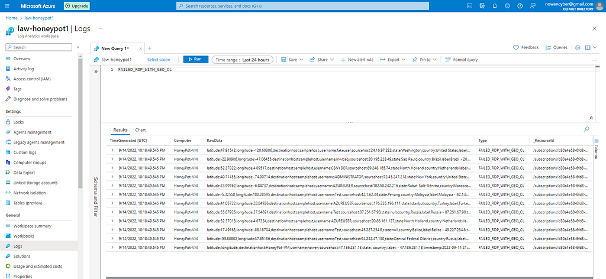

*Running the Custom Log Query*

To map the data, I needed to take the raw data and extract specific fields from it to create separate areas for the latitude, longitude, country, etc.

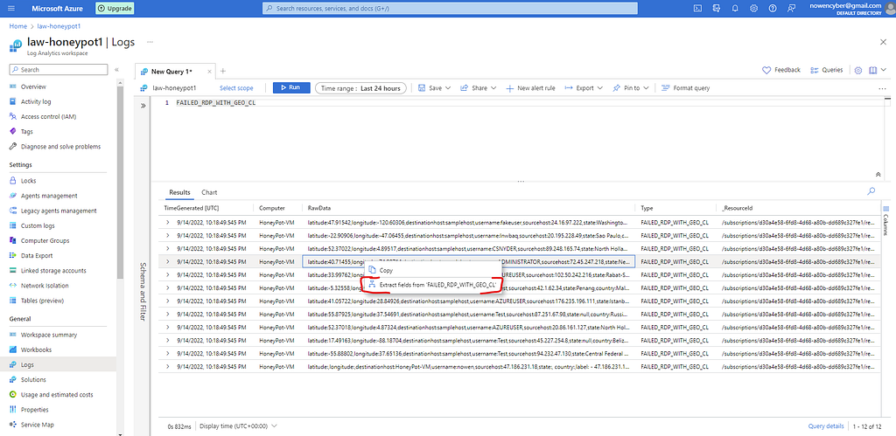

*Extracting the Data*

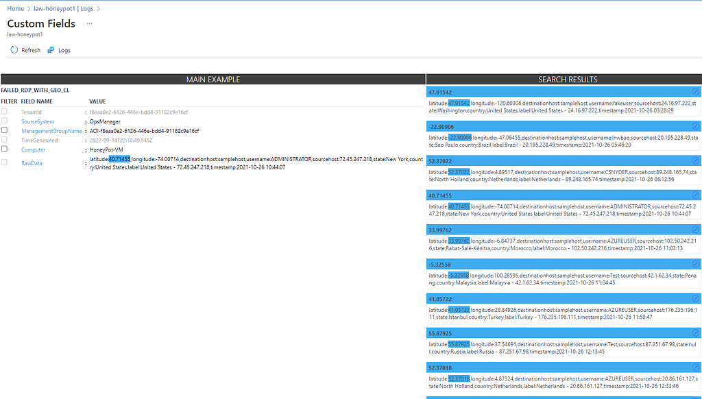

*Checking the Results of the Query*

Starting with latitude, I highlighted the numeric value and queried the log. I now needed to review the data to make sure everything was accurate, and everything seemed in order, so I saved the extraction. Future extractions would require me to edit and fix the results. I continued to do this for latitude, longitude, username, etc. The more I did this the more accurate the extract algorithm became at detecting the correct data without error.

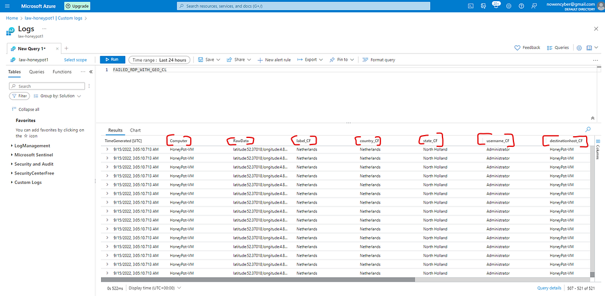

*Custom Values Displaying Properly*

Now that I had my custom fields to organize all the separate data, it was time to get everything plotted on a map so we could see the location of the attackers.

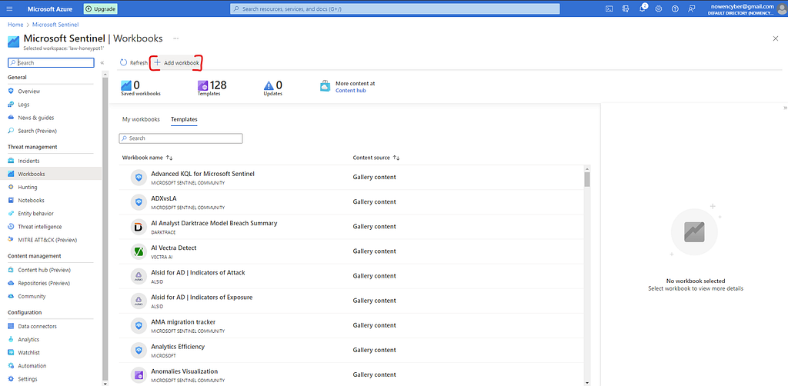

*Creating the Workbook*

I had to add a new workbook in sentinel and create a new query. Once completed, I could change the visualization to a map, and edit the map settings to use the custom fields we created earlier. Now the map was finally created, and ready to plot out the cyber attacks our VM will receive.

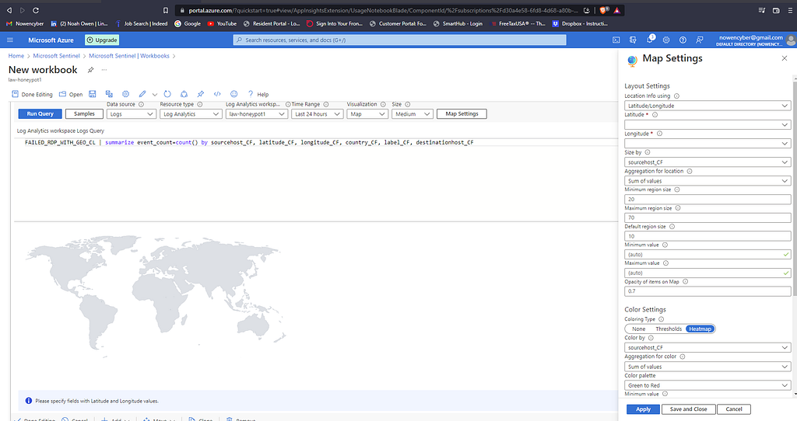

*Setting up the Map*

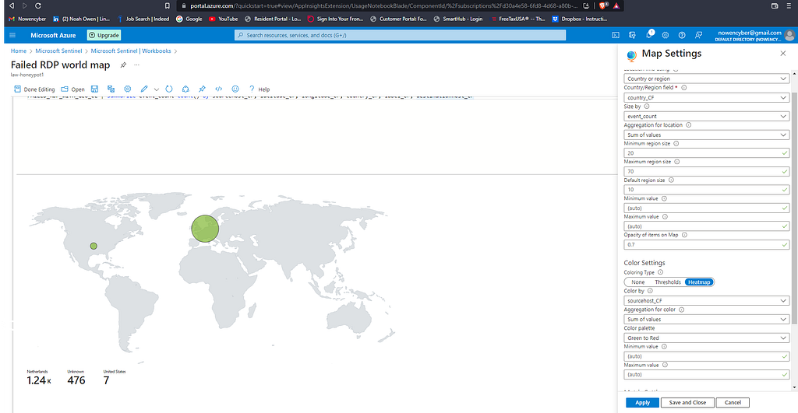

*The Completed Map!*

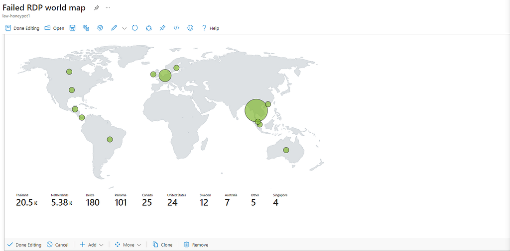

*A few Days Later, Many Other Countries Attacking*

In conclusion, the lab provided a practical demonstration of the importance of cybersecurity in today’s interconnected world. The map showed several failed login attempts originating from countries such as the Netherlands and the US, among others. These attacks serve as a reminder of the constant threat that exists to our digital assets and the need for strong password security. The lab gave me hands-on experience using Azure and increased my understanding of cloud services and their role in cybersecurity. By performing the lab, I was able to appreciate the significance of securing your online presence and understand the measures one can take to prevent unauthorized access to their information. The knowledge and skills acquired from this lab will be valuable in ensuring the safety of my digital assets in the future.

I have successfully completed the SIEM Tutorial For Beginners Lab as outlined by [Josh Madakor — Tech, Education, Career](https://www.youtube.com/@JoshMadakor). If you would like to complete the lab yourself it can be accessed with the link below.

[https://www.youtube.com/watch?v=H8W9oMNSuwo&list=PLxbwE86jKRgMpuZuLBivzlM8s2Dk5lXBQ](https://www.youtube.com/watch?v=H8W9oMNSuwo&list=PLxbwE86jKRgMpuZuLBivzlM8s2Dk5lXBQ).
